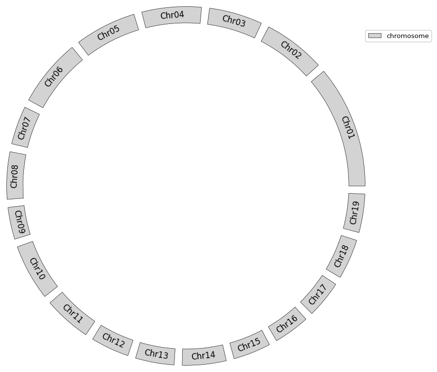
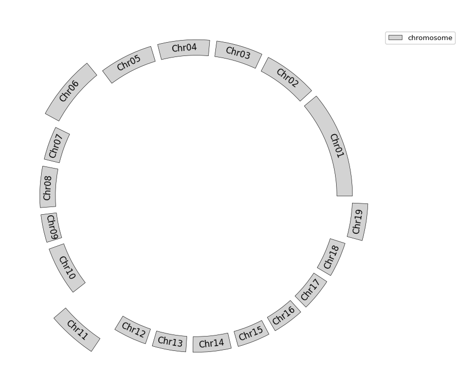
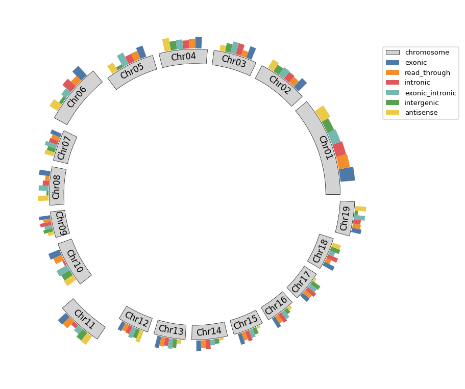
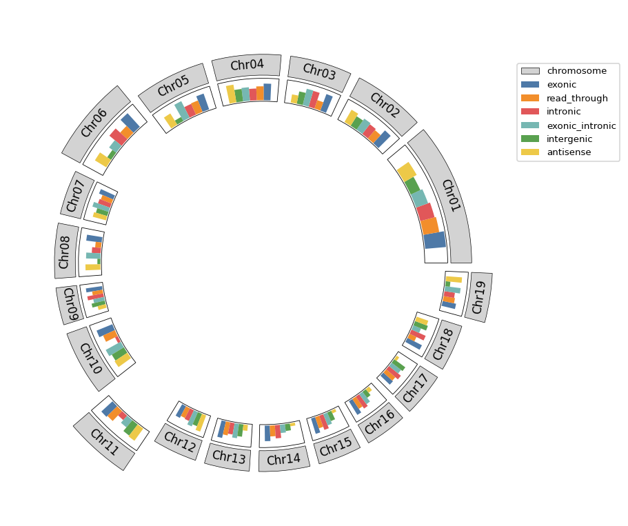
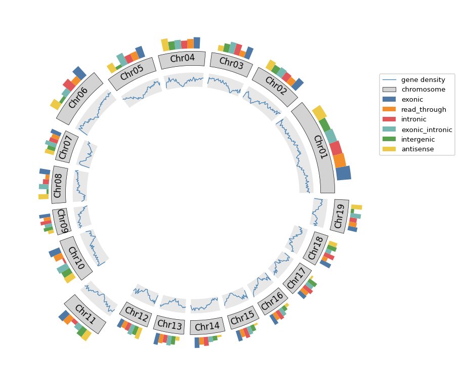
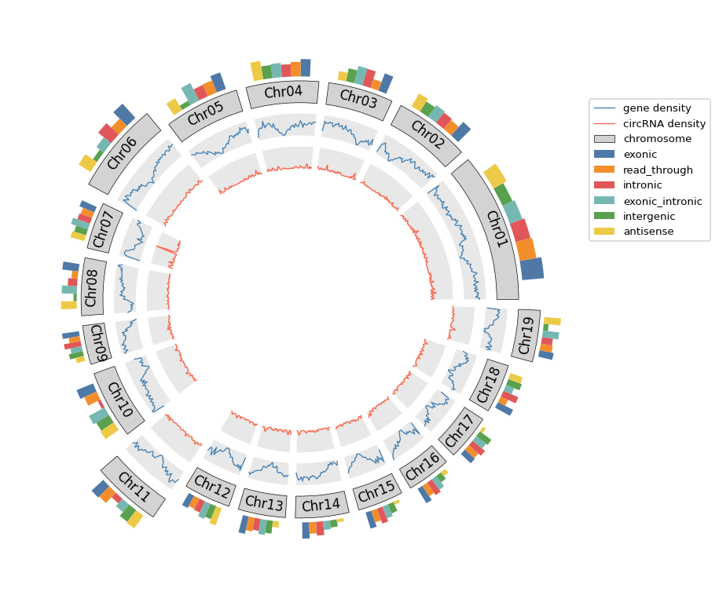
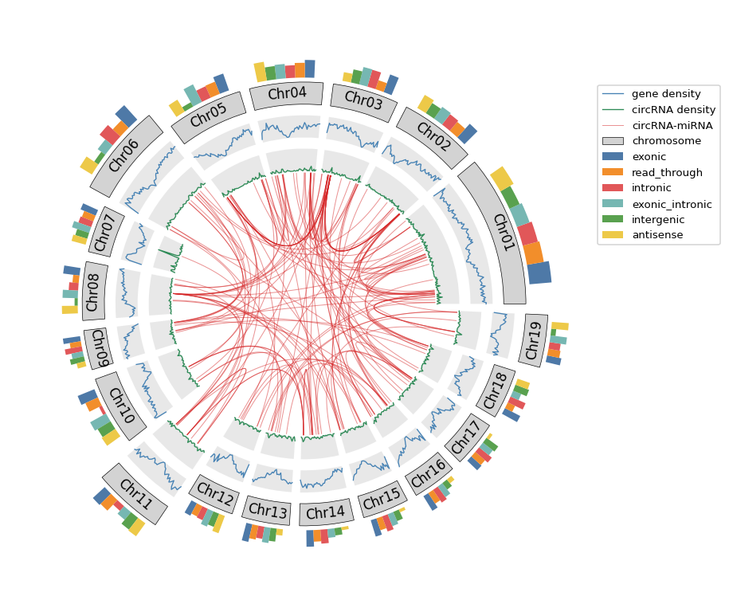
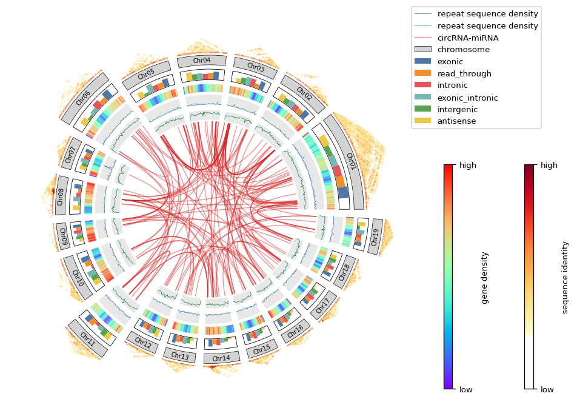
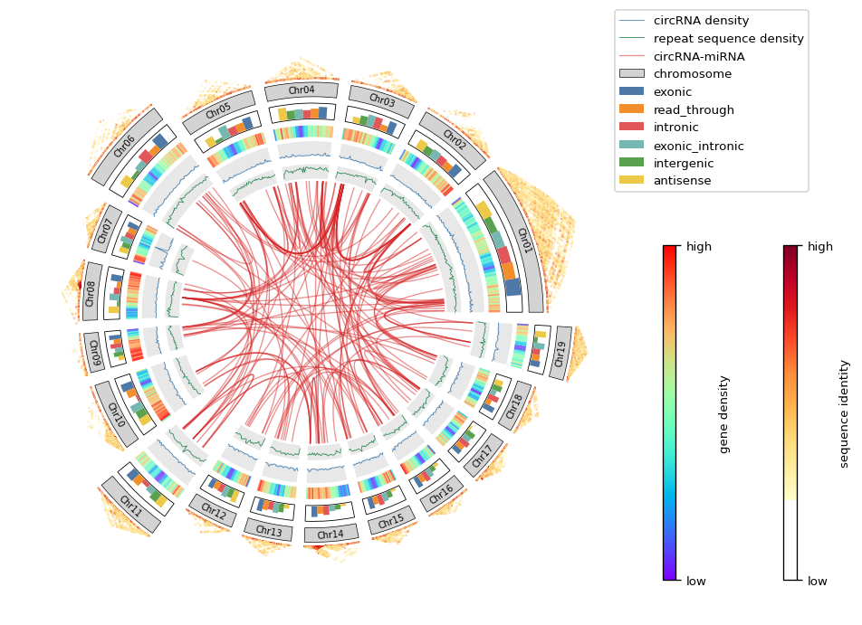

# Usage example
## 1. Show chromosome.
### Place all the chromosomes on the same ring.
```python
from genome_circos import ChromosomeCircos

cc = ChromosomeCircos(
    chr_len_file='example/chr_len.txt',  # chromosome length file (ChrName\tChrLen\tEtc)
    spacing=4,  # set the spacing between chromosomes to be one quarter of the shortest chromosome
    font=None,  # use default font of matplotlib.rcParams['font.family']
    font_size=8,  # global font size
    figsize=(10, 8),  # figure dimension (width, height) in inches
    dpi=120  # dots per inch
)

ax = cc.chr_bar(
    height=1,  # chromosome bar height
    bottom=10,  # chromosome bar bottom y-axis coordinate
    face_color='lightgrey',  # chromosome bar fill colr
    edge_color='black',  # chromosome bar border colr
    line_width=0.4,  # chromosome bar border width
    font_size=10  # chromosome name font size
)

ax.legend(loc=(0.999, 0.9))
cc.save('example/1.png')
```

### List all available fonts on your system.
```python
import matplotlib.font_manager as fm

all_fonts = fm.findSystemFonts()
font_names = [f.name for f in fm.fontManager.ttflist]
unique_fonts = sorted(set(font_names))
for idx, font in enumerate(unique_fonts, 1):
    print(f"{idx}. {font}")
```
### Make some chromosomes protrude outward.
```python
from genome_circos import ChromosomeCircos

cc = ChromosomeCircos(
    chr_len_file='example/chr_len.txt',  # chromosome length file (ChrName\tChrLen\tEtc)
    spacing=4,  # set the spacing between chromosomes to be one quarter of the shortest chromosome
    font=None,  # use default font of matplotlib.rcParams['font.family']
    font_size=8,  # global font size
    figsize=(10, 8),  # figure dimension (width, height) in inches
    dpi=120  # dots per inch
)

bottom = [9, 9, 9, 9, 9, 10, 9, 9, 9, 9, 11, 9, 9, 9, 9, 9, 9, 9, 10]

ax = cc.chr_bar(
    height=1,  # chromosome bar height
    bottom=bottom,  # chromosome bar bottom y-axis coordinate
    face_color='lightgrey',  # chromosome bar fill colr
    edge_color='black',  # chromosome bar border colr
    line_width=0.4,  # chromosome bar border width
    font_size=10  # chromosome name font size
)

ax.legend(loc=(0.999, 0.9))
cc.save('example/2.png')
```


## 2. Count the number of different features on each chromosome.
```python
from genome_circos import ChromosomeCircos

cc = ChromosomeCircos(
    chr_len_file='example/chr_len.txt',  # chromosome length file (ChrName\tChrLen\tEtc)
    spacing=4,  # set the spacing between chromosomes to be one quarter of the shortest chromosome
    font=None,  # use default font of matplotlib.rcParams['font.family']
    font_size=8,  # global font size
    figsize=(10, 8),  # figure dimension (width, height) in inches
    dpi=120  # dots per inch
)

bottom = [9, 9, 9, 9, 9, 10, 9, 9, 9, 9, 11, 9, 9, 9, 9, 9, 9, 9, 10]

ax = cc.chr_bar(
    height=1,  # chromosome bar height
    bottom=bottom,  # chromosome bar bottom y-axis coordinate
    face_color='lightgrey',  # chromosome bar fill colr
    edge_color='black',  # chromosome bar border colr
    line_width=0.4,  # chromosome bar border width
    font_size=10  # chromosome name font size
)

cc.bar(
    axes=ax,  # axes object of matplotlib.axes.Axes.
    stat_file='example/stat.txt',  # feature statistics file (ChrName\tFeatureType\tCount\tColor)
    bottom=[i + 1.05 for i in bottom],  # bottom y-axis coordinate of statistic bar on each chromosome
    height=1,  # height of statistical bar
    frame=False  # do not add borders to the bar charts on each chromosome
)

ax.legend(loc=(0.999, 0.7))
cc.save('example/3.png')
```

Or move the bar chart to the inner circle.
```python
from genome_circos import ChromosomeCircos

cc = ChromosomeCircos(
    chr_len_file='example/chr_len.txt',  # chromosome length file (ChrName\tChrLen\tEtc)
    spacing=4,  # set the spacing between chromosomes to be one quarter of the shortest chromosome
    font=None,  # use default font of matplotlib.rcParams['font.family']
    font_size=8,  # global font size
    figsize=(10, 8),  # figure dimension (width, height) in inches
    dpi=120  # dots per inch
)

bottom = [9, 9, 9, 9, 9, 10, 9, 9, 9, 9, 11, 9, 9, 9, 9, 9, 9, 9, 10]

ax = cc.chr_bar(
    height=1,  # chromosome bar height
    bottom=bottom,  # chromosome bar bottom y-axis coordinate
    face_color='lightgrey',  # chromosome bar fill colr
    edge_color='black',  # chromosome bar border colr
    line_width=0.4,  # chromosome bar border width
    font_size=10  # chromosome name font size
)

cc.bar(
    axes=ax,  # axes object of matplotlib.axes.Axes.
    stat_file='example/stat.txt',  # feature statistics file (ChrName\tFeatureType\tCount\tColor)
    bottom=[i - 1.2 for i in bottom],  # bottom y-axis coordinate of statistic bar on each chromosome
    height=1,  # height of statistical bar
    frame=True  # add borders to the bar charts on each chromosome
)

ax.legend(loc=(0.999, 0.7))
cc.save('example/4.png')
```


## 3. Show feature density on each chromosome.
### Show gene density.
```python
from genome_circos import ChromosomeCircos

cc = ChromosomeCircos(
    chr_len_file='example/chr_len.txt',  # chromosome length file (ChrName\tChrLen\tEtc)
    spacing=4,  # set the spacing between chromosomes to be one quarter of the shortest chromosome
    font=None,  # use default font of matplotlib.rcParams['font.family']
    font_size=8,  # global font size
    figsize=(10, 8),  # figure dimension (width, height) in inches
    dpi=120  # dots per inch
)

bottom = [9, 9, 9, 9, 9, 10, 9, 9, 9, 9, 11, 9, 9, 9, 9, 9, 9, 9, 10]

ax = cc.chr_bar(
    height=1,  # chromosome bar height
    bottom=bottom,  # chromosome bar bottom y-axis coordinate
    face_color='lightgrey',  # chromosome bar fill colr
    edge_color='black',  # chromosome bar border colr
    line_width=0.4,  # chromosome bar border width
    font_size=10  # chromosome name font size
)

cc.bar(
    axes=ax,  # axes object of matplotlib.axes.Axes.
    stat_file='example/stat.txt',  # feature statistics file (ChrName\tFeatureType\tCount\tColor)
    bottom=[i + 1.2 for i in bottom],  # bottom y-axis coordinate of statistic bar on each chromosome
    height=1,  # height of statistical bar
    frame=False  # add borders to the bar charts on each chromosome
)

cc.plot(
    gene_density_file='example/gene_density.txt',  # feature density file (ChrName\tStart\tEnd\tCount)
    axes=ax,
    bottom=[i - 1.5 for i in bottom],  # y-axis coordinate bottom of gene density chart for each chromosome
    height=1,  # curve height
    line_width=0.8,  # gene density curve width for each chromosome.
    color='steelblue',  # density curve color
    label='gene density',  # density curve label
    **{'facecolor': 'lightgrey', 'alpha': 0.5}  # background frame attribute dict
)

ax.legend(loc=(0.999, 0.6))
cc.save('example/5.png')
```

### Show circRNA density.
```python
from genome_circos import ChromosomeCircos

cc = ChromosomeCircos(
    chr_len_file='example/chr_len.txt',  # chromosome length file (ChrName\tChrLen\tEtc)
    spacing=4,  # set the spacing between chromosomes to be one quarter of the shortest chromosome
    font=None,  # use default font of matplotlib.rcParams['font.family']
    font_size=8,  # global font size
    figsize=(10, 8),  # figure dimension (width, height) in inches
    dpi=120  # dots per inch
)

bottom = [9, 9, 9, 9, 9, 10, 9, 9, 9, 9, 11, 9, 9, 9, 9, 9, 9, 9, 10]

ax = cc.chr_bar(
    height=1,  # chromosome bar height
    bottom=bottom,  # chromosome bar bottom y-axis coordinate
    face_color='lightgrey',  # chromosome bar fill colr
    edge_color='black',  # chromosome bar border colr
    line_width=0.4,  # chromosome bar border width
    font_size=10  # chromosome name font size
)

cc.bar(
    axes=ax,  # axes object of matplotlib.axes.Axes.
    stat_file='example/stat.txt',  # feature statistics file (ChrName\tFeatureType\tCount\tColor)
    bottom=[i + 1.2 for i in bottom],  # bottom y-axis coordinate of statistic bar on each chromosome
    height=1,  # height of statistical bar
    frame=False  # add borders to the bar charts on each chromosome
)

cc.plot(
    gene_density_file='example/gene_density.txt',  # feature density file (ChrName\tStart\tEnd\tCount)
    axes=ax,
    bottom=[i - 1.5 for i in bottom],  # y-axis coordinate bottom of gene density chart for each chromosome
    height=1,  # curve height
    line_width=0.8,  # gene density curve width for each chromosome.
    color='steelblue',  # density curve color
    label='gene density',  # density curve label
    **{'facecolor': 'lightgrey', 'alpha': 0.5}  # background frame attribute dict
)

cc.plot(
    gene_density_file='example/circ_density.txt',
    axes=ax,
    bottom=[i - 3 for i in bottom],
    height=1,  # curve height
    line_width=0.8,  # gene density curve width for each chromosome.
    color='tomato',
    label='circRNA density',
    **{'facecolor': 'lightgrey', 'alpha': 0.5}  # background frame attribute dict
)

ax.legend(loc=(0.999, 0.6))
cc.save('example/6.png')
```


## 4. Link the two loci on the genome that interact with each other.
```python
from genome_circos import ChromosomeCircos

cc = ChromosomeCircos(
    chr_len_file='example/chr_len.txt',  # chromosome length file (ChrName\tChrLen\tEtc)
    spacing=4,  # set the spacing between chromosomes to be one quarter of the shortest chromosome
    font=None,  # use default font of matplotlib.rcParams['font.family']
    font_size=8,  # global font size
    figsize=(10, 8),  # figure dimension (width, height) in inches
    dpi=120  # dots per inch
)

bottom = [9, 9, 9, 9, 9, 10, 9, 9, 9, 9, 11, 9, 9, 9, 9, 9, 9, 9, 10]

ax = cc.chr_bar(
    height=1,  # chromosome bar height
    bottom=bottom,  # chromosome bar bottom y-axis coordinate
    face_color='lightgrey',  # chromosome bar fill colr
    edge_color='black',  # chromosome bar border colr
    line_width=0.4,  # chromosome bar border width
    font_size=10  # chromosome name font size
)

cc.bar(
    axes=ax,  # axes object of matplotlib.axes.Axes.
    stat_file='example/stat.txt',  # feature statistics file (ChrName\tFeatureType\tCount\tColor)
    bottom=[i + 1.2 for i in bottom],  # bottom y-axis coordinate of statistic bar on each chromosome
    height=1,  # height of statistical bar
    frame=False  # add borders to the bar charts on each chromosome
)

cc.plot(
    gene_density_file='example/gene_density.txt',  # feature density file (ChrName\tStart\tEnd\tCount)
    axes=ax,
    bottom=[i - 1.5 for i in bottom],  # y-axis coordinate bottom of gene density chart for each chromosome
    height=1,  # curve height
    line_width=0.8,  # gene density curve width for each chromosome.
    color='steelblue',  # density curve color
    label='gene density',  # density curve label
    **{'facecolor': 'lightgrey', 'alpha': 0.5}  # background frame attribute dict
)

cc.plot(
    gene_density_file='example/circ_density.txt',
    axes=ax,
    bottom=[i - 3 for i in bottom],
    height=1,  # curve height
    line_width=0.8,  # gene density curve width for each chromosome.
    color='SeaGreen',
    label='circRNA density',
    **{'facecolor': 'lightgrey', 'alpha': 0.5}  # background frame attribute dict
)

cc.links(
    axes=ax,
    link_file='example/link.txt',  # associated site file (ChrName\tStart\tEnd\tChrName\tStart\tEnd\tColor\tLabel)
    bottom=[i - 3.1 for i in bottom],
    line_width=0.6,
    alpha=0.5
)

ax.legend(loc=(0.999, 0.6))
cc.save('example/7.png')
```

**Show hypothetical inversion**
```python
from genome_circos import ChromosomeCircos

cc = ChromosomeCircos(
    chr_len_file='example/chr_len.txt',  # chromosome length file (ChrName\tChrLen\tEtc)
    spacing=4,  # set the spacing between chromosomes to be one quarter of the shortest chromosome
    font=None,  # use default font of matplotlib.rcParams['font.family']
    font_size=8,  # global font size
    figsize=(10, 8),  # figure dimension (width, height) in inches
    dpi=120  # dots per inch
)

bottom = [9, 9, 9, 9, 9, 10, 9, 9, 9, 9, 11, 9, 9, 9, 9, 9, 9, 9, 10]

ax = cc.chr_bar(
    height=1,  # chromosome bar height
    bottom=bottom,  # chromosome bar bottom y-axis coordinate
    face_color='lightgrey',  # chromosome bar fill colr
    edge_color='black',  # chromosome bar border colr
    line_width=0.4,  # chromosome bar border width
    font_size=10  # chromosome name font size
)

cc.bar(
    axes=ax,  # axes object of matplotlib.axes.Axes.
    stat_file='example/stat.txt',  # feature statistics file (ChrName\tFeatureType\tCount\tColor)
    bottom=[i + 1.2 for i in bottom],  # bottom y-axis coordinate of statistic bar on each chromosome
    height=1,  # height of statistical bar
    frame=False  # add borders to the bar charts on each chromosome
)

cc.plot(
    gene_density_file='example/gene_density.txt',  # feature density file (ChrName\tStart\tEnd\tCount)
    axes=ax,
    bottom=[i - 1.5 for i in bottom],  # y-axis coordinate bottom of gene density chart for each chromosome
    height=1,  # curve height
    line_width=0.8,  # gene density curve width for each chromosome.
    color='steelblue',  # density curve color
    label='gene density',  # density curve label
    **{'facecolor': 'lightgrey', 'alpha': 0.5}  # background frame attribute dict
)

cc.plot(
    gene_density_file='example/circ_density.txt',
    axes=ax,
    bottom=[i - 3 for i in bottom],
    height=1,  # curve height
    line_width=0.8,  # gene density curve width for each chromosome.
    color='SeaGreen',
    label='circRNA density',
    **{'facecolor': 'lightgrey', 'alpha': 0.5}  # background frame attribute dict
)

cc.link_region(
    axes=ax,
    chr1='Chr01',
    s1=12000000,
    e1=13000000,
    y1=5.9,
    chr2='Chr03',
    s2=5000000,
    e2=10000000,
    y2=5.9,
    line_width=1,
    line_color='tomato',
    line_alpha=None,
    fill_color='tomato',
    fill_alpha=0.6,
    label='inversion',
    label_color='black',
    label_alpha=1,
    label_size=8
)

ax.legend(loc=(0.999, 0.6))
cc.save('example/8.png')
```


## 5. All steps.
```python
from genome_circos import ChromosomeCircos

cc = ChromosomeCircos(
    chr_len_file='example/chr_len.txt',
    spacing=3,
    font=None,
    font_size=8,
    figsize=(10, 8),
    dpi=120
)

bottom = [15, 15, 15, 15, 15, 17, 15, 15, 15, 15, 18, 15, 15, 15, 15, 15, 15, 15, 17]

ax = cc.chr_bar(
    bottom=bottom,
    height=1,
    face_color='lightgrey',
    edge_color='black',
    line_width=0.4,
    font_size=6
)

# show sequence identity
cc.identity_heatmap(
    cis_acting_file='example/region_identity.txt',
    matches_cutoff=3000,
    axes=ax,
    bottom=[i + 1.3 for i in bottom],
    height=3,
    marker_size=0.01,
    cmap='YlOrRd',
    orientation='vertical',
    anchor=(0.5, 0.2)
)

cc.bar(
    axes=ax,
    stat_file='example/stat.txt',
    bottom=[i - 1.5 for i in bottom],
    height=1,
    frame=True  # disable borders
)

# show circRNA density curve
cc.plot(
    gene_density_file='example/circ_density.txt',
    axes=ax,
    bottom=[i - 4.1 for i in bottom],
    height=1,
    line_width=0.5,
    color='steelblue',
    label='circRNA density',
    **{'facecolor': 'lightgrey', 'alpha': 0.5}  # background frame attribute dict
)

# show repeat sequence density curve
cc.plot(
    gene_density_file='example/repeat_density.txt',
    axes=ax,
    bottom=[i - 5.7 for i in bottom],
    height=1,
    line_width=0.5,
    color='SeaGreen',
    label='repeat sequence density',
    **{'facecolor': 'lightgrey', 'alpha': 0.5}  # background frame attribute dict
)

cc.links(
    axes=ax,
    link_file='example/link.txt',
    bottom=[i - 5.9 for i in bottom],
    line_width=0.8,
    alpha=0.5
)

# show gene density heatmap
# note: density_heatmap must be placed at the very end
cc.density_heatmap(
    gene_density_file='example/gene_density.txt',
    axes=ax,
    bottom=[i - 2.8 for i in bottom],
    height=0.8,  # heatmap height
    linewidths=1,  # gene density heatmap curve width for each chromosome
    cmap='rainbow',  # color map, see https://matplotlib.org/stable/gallery/color/colormap_reference.html
    label='gene density',
    n_min=0,  # the data value mapped to the bottom of the colormap (i.e. 0)
    n_max=80,  # the data value mapped to the top of the colormap (i.e. 1).
    orientation='vertical',  # color bar orientation
    anchor=(0.5, 0.2)
)

ax.legend(loc=(0.999, 0.7))
cc.save('example/9.png')
```


**Tips: Use the "bottom" parameter of each plotting function to control the distance between each circle in the Circos graph.**

**More detail params see [example file](example).**